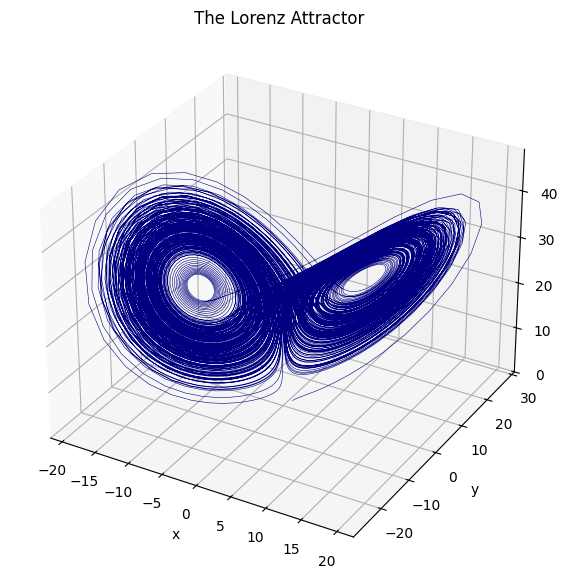

# Research Log

## 2026-05-27

**Worked on:** 

- Project planning and environment setup.

- 3Blue1Brown linear algebra series (math prep)

**Setup completed:**

- Python 3.12 installed

- Virtual environment created

- Core scientific Python stack installed (numpy, scipy, matplotlib, jupyter, pytorch)

- VSCode + Git configured

- Project folder structure created

- Git repository initialized

**Progress:**

- Identified research direction: ML for QPIT identification in CR3BP

**Stuck on / questions:**

- None yet — setup phase

**Next session:**

- Begin reading Koon et al. Chapter 1

## 2026-05-28

**Worked on:** 

- Further planning, math learning, and environment setup

**Setup completed:**

- Got the titan environment setup

**Reading completed:**

- Completed learning a basic understanding of linear algebra

**Stuck on / questions:**

- Is there any other ways of going about eigenvectors and eigendecomposition

**Next session:**

- Learn multivariable calc and read Koon and Olikara

-*Important notes
- - on titan the are three partition that are useful: bw (the main one), sb (larger one), and gpu (contains gpus)
- - sb and gpu could be used later for greater processing
- - on bw, PreemptMode=REQUEUE, this means jobs should be checkpointable or idempotent (smaller separate jobs)

## 2026-05-29

**Worked on:** 

- Multivarible calc

**Reading completed:**

- Gained a basic understanding of multivarible equations

**Stuck on / questions:**

- None yet — setup phase

**Next session:**

- Learn multivariable calc and read Koon and Olihara

## 2026-05-31

**Worked on:** 

- Multivarible calc

**Reading completed:**

- Learned about partial derivatives of multivarible equations

**Stuck on / questions:**

- None yet — setup phase

**Next session:**

- Learn multivariable calc and read Koon and Olihara

## 2026-06-01

**Worked on:** 

- Multivarible calc

**Reading completed:**

- Learned about gradient and directional derivatives

**Stuck on / questions:**

- None yet — setup phase

**Next session:**

- Learn multivariable calc and read Koon and Olikara

## 2026-06-03

**Worked on:** 

- Multivarible calc

**Reading completed:**

- Learned about the chain rule for multivar and about curvature

**Stuck on / questions:**

- None yet — setup phase

**Next session:**

- Learn multivariable calc and read Koon and Olikara

## 2026-06-04

**Worked on:** 

- Multivarible calc

**Reading completed:**

- Learned about divergence and curl for vector-valued functions

**Stuck on / questions:**

- None yet — setup phase

**Next session:**

- Learn multivariable calc, specifically Laplacian and Jacobian, and read Koon and Olihara

## 2026-06-05

**Worked on:** 

- Multivarible calc

**Reading completed:**

- Learned about Jacobian, Laplacian, Lagrangian, tangent planes, and quadratic approximations.

**Stuck on / questions:**

- None yet — setup phase

**Next session:**

- Learn multivariable calc, specifically line integrals, and read Koon and Olikara

## 2026-06-06

**Worked on:** 

- Multivarible calc and reading

**Reading completed:**

- Learned about line integrals and read the first chapters of Koon and Olikara

**Stuck on / questions:**

- None yet — setup phase

**Next session:**

- Learn multivariable calc, specifically double integrals

## 2026-06-07

**Worked on:** 

- Multivarible calc

**Reading completed:**

- Learned about double integrals and triple integrals

**Stuck on / questions:**

- None yet — setup phase

**Next session:**

- Going to a summer camp and will have very little time to study Multivar Calc, will not be able to add entries into this log

## 2026-06-14

**Worked on:** 

- Came back from summer camp and worked on multivarible calc

**Reading completed:**

- Learned about surface integrals

**Stuck on / questions:**

- None yet — setup phase

**Next session:**

- Multivar calc, specifically flux and different theorems

## 2026-06-15

**Worked on:** 

- Multivarible calc

**Reading completed:**

- Learned about Stokes' theorem and variations of it

**Stuck on / questions:**

- None yet — setup phase

**Next session:**

- Final confirmation of comprehension of multivar calc and beginning ordinary diff eq

## 2026-06-16

**Worked on:** 

- Multivarible calc and ODE

**Reading completed:**

- Confirmed fluency of multivar and began learning ODE

**Stuck on / questions:**

- None yet — setup phase

**Next session:**

- Continuing ODE

## 2026-06-18

**Worked on:** 

- ODE

**Reading completed:**

- Watched the first few MIT OCW videos for ODE and began the first problem set.

**Stuck on / questions:**

- None yet — setup phase

**Next session:**

- Continuing ODE

## 2026-06-19

**Worked on:** 

- ODE and the cr3bp integrator

**Reading completed:**

- Finished the first ODE problem set

- Read the second chapter of Koon

**Progress:**
- Confirmed that the cr3bp integrator worked

-Tested Jacobi conservation when starting with small velocity near L4 - passed
-Tested Jacobi conservation when starting near L1 - failed
-Tested Jacobi conservation when starting with tangential velocity near Earth - failed
-Tested Jacobi conservation when starting near the Moon - failed

-Plotted the zero-velocity curves for several Jacobi constants

**Amended 8-14**

- The 06-19 conservation failures were never closed out in this log
- Re-running the same four tests at rtol = atol = [___] gives max |ΔC/C| of 
- [___] (L4)
- [___] (L1)
- [___] (near-Earth tangential)
- [___] (near-Moon)
- The Week 2 gate required ~1e-10; [these pass / these fail and here is what I did]

**Stuck on / questions:**

- None yet — setup phase

**Next session:**

- Continuing ODE

## 2026-06-20

**Worked on:** 

- ODE

**Reading completed:**

- Learned about systems of ODE

**Stuck on / questions:**

- None yet — setup phase

**Next session:**

- Continuing ODE

## 2026-06-22

**Worked on:** 

- ODE

**Reading completed:**

- Learned how to classify fixed points of system of ODE

- Read Pathak and learned about reservoir computing

**Stuck on / questions:**

- None yet — setup phase

**Next session:**

- Building a Lorenz Reservoir Computer

## 2026-06-23

**Worked on:** 

- Lorenz Reservoir Computer

**Reading completed:**

- Pytorch 60 Minute Blitz

**Progress:**

- Tested the cr3bp integrator on the Titan
- It worked but produced the greatest deviation around L1
- This is most likely due to L1 being the most chaotic

- Began the Reservoir Computer with the Lorenz Equations  
- The Lorenz attractor is just so beautiful

- When building the reservoir, it did not work unless it was fed normalized values
- It would be smart to normalize values down the line for the actual QPIT identifier too
- Its important to note that a model that scores well on training data may not score well on data it has never seen before
- The finished reservoir computer was able to match real values for around 2 Lyapunov times
- This result is worse than that of Pathak but the bug fixing and process were enough to learn the mechanics of a reservoir computer

**Amended 8-14**

- My 06-23 attribution of the L1 deviation to chaos was incomplete
- C is an exact integral of motion, so chaos cannot break conservation
- What degrades near L1 is the 1/r² and 1/r³ terms making the mechanics of the cr3bp locally stiff, which raises the integrator's local error per step
- Chaos amplifies the resulting state error but is not the source

**Stuck on / questions:**

- None yet — setup phase

**Next session:**

- Finishing ODE

## 2026-06-24

**Worked on:** 

- ODE 

**Reading completed:**

- Learned about nonlinear systems of ODE
- Learned you can use the local linearization to gain information about the phase portrait

**Stuck on / questions:**

- None yet — setup phase

**Next session:**

- Finishing ODE and dynamical systems

## 2026-06-25

**Worked on:** 

- ODE and dynamical systems

**Reading completed:**

- Read Ch. 6 and 7 of Strogatz

**Stuck on / questions:**

- None yet — setup phase

**Next session:**

- Continuing dynamical Systems

## 2026-06-26

**Worked on:** 

- Reading

**Reading completed:**

- Read Koon Ch. 3

**Stuck on / questions:**

- None yet — setup phase

**Next session:**

- Continuing Reading

## 2026-06-27

**Worked on:** 

- Reading

**Reading completed:**

- Read Olikara Ch. 2 and Howell

**Stuck on / questions:**

- None yet — setup phase

**Next session:**

- Developing the single-shooting differential corrector

## 2026-06-28

**Worked on:** 

- Jacobian and STM integration

**Progress:**

- Derived the Jacobian for the CR3BP system

- Validated the STM against small differences and it worked greatly

**Stuck on / questions:**

- None yet — setup phase

**Next session:**

- Developing the single-shooting differential corrector

## 2026-06-29

**Worked on:** 

- Single-Shooting Differential Corrector

**Progress:**

- Built the single-shooting differential corrector and used it to find the first periodic orbit of the project

- Used the eigenvectors of the Jacobian Matrix around L1 to get a good initial guess then used the differential corrrector to quadratically converge closer and closer to real orbit

- The final QPIT identifier could be used to generate initial guesses for a similar process

- Generated a families of Lyapunov orbits around L1 and L2
- Ran into errors and diffulcties with the differential corrector jumping to different branches of families or zeroing out
- This error was caused by using a fix distance between consecutive orbits
- Fixed by using a pseudo arclength

**Stuck on / questions:**

- None yet — setup phase

**Next session:**

- Floquet Theory

## 2026-06-29 (part 2)
# Did a lot today so decided to split it up

**Worked on:** 

- Floquet theory

**Reading completed:**

- What I learned today connected everything of the project so far
- I now have a much better understanding of the mechanics

- I previously thought that QPITs were an entirely different thing from periodic orbits but now I understand that they revolve around a certain type of them
- They are orbits with two frequencies, the first one is the same as a normal periodic orbit
- What makes it a torus is its second frequency which makes a circle perpendicular to the path of the first orbit
- What makes it quasi-periodic is that the ratio of the frequencies is irrational, they path of the orbit never lines up with itself when it comes back around

- Also, floquet theory is an amazing way of understanding orbits

- Used it to calculate that the families of orbits I produced earlier were all hyperbolic
- This fact means that they are likely no tori around them
- Tori are near stable orbits, so in the future it would be best to investigate halo, or other orbits

**Amended 8/17**
- Two corrections to this entry:
- First, "tori are near stable orbits" is wrong
- Tori require a center (elliptic) direction, not stability
- The halo orbits I moved to in Week 6 have a saddle pair at λ ≈ 2024.6 alongside a center pair at 0.97301 ± 0.23077j
- This orbit is strongly unstable and elliptic at the same time, and the center pair is the reason tori exist there
- Second, "the families I produced were all hyperbolic" is true only of my planar Lyapunov families where there is no out-of-plane direction to be elliptic in
- In the spatial problem a planar Lyapunov orbit does carry an out-of-plane center pair, so the statement needs that qualifier

**Stuck on / questions:**

- None yet — setup phase

**Next session:**

- Halo Orbits

## 2026-06-30

**Worked on:** 

- Manifolds

**Reading completed:**

- Read Koon Ch. 4, Gomez, and the first half of Burden & Faires Ch. 5

- Hartman-Grobman legitimizes the method of findind manifolds from a periodic orbit'
- At the point where the two over lap they are tangent, thus the linearization of the periodic orbit at a point can be used to find the start or end of a manifold

**Progress:**

- Generated stable and unstable manifolds for a L1 Lyapunov orbit
- Unstable comes from and stable goes into the orbit
- The manifolds assymptotically approaches and comes from the orbit

- In preperation for halo orbits, I expanded the existing system into 3d (because halos are 3d) and created a new, more complex jacobian and STM to accompany it
- This STM was validated and is ready to produce halos

**Amended 8/17**

- "Hartman-Grobman" is incorrect, the Stable Manifold Theorem is instead
- 3D CR3BP equations of motion, 6×6 Jacobian, and 42-dimensional STM all validated to 1e-10 against finite differences.

**Stuck on / questions:**

- None yet — setup phase

**Next session:**

- Halo Orbits

## 2026-07-01

**Worked on:** 

- Halo Orbits

**Progress:**

- Calculated families of Halo Orbits around L1 and L2 using all of the preexisting infrastructure of the project

- These are where I suspect QPITs to live around and the monodromy eigenvalues already have center pairs
- I am right on the cusp of calculating QPITs for this project

**Stuck on / questions:**

- None yet — setup phase

**Next session:**

- QPIT reading

## 2026-07-02

**Worked on:** 

- Halo Orbits Floquet Analysis

**Progress:**

- Analysed the floquet multipliers of the Halo Families I generated to look for where QPITs could be near

- The two best candidates:
- L1 orbit 16 — C = 3.077, ρ/2π = 0.272
- L2 orbit 29 — C = 3.060, ρ/2π = 0.295

- This is my last real session before going to the National Youth Science Camp
- At camp I will:  
- -Read all relevent material about generating QPITs
- -Choose the method I will implement to actually do so
- -And reach out to Olikara and Baresi asking for their help

- All of this will be in preparation for when I come back from camp in a month
- When I come back, I will be jumping straight into the most difficult part of the project: Computing QPITs
- Hopefully all of the preparation of done before camp and will do during camp will set me up to succeed after it
- So until I return, Goodbye

**Stuck on / questions:**

- None yet — setup phase

**Next session:**

- QPIT Computation

## 2026-08-03

**Worked on:** 

- Reading and Emails

- I have come back from summer camp and decided to ease into my research

**Reading completed:**

- Began reading McCarthy & Howell, AAS 19-329

**Progress:**

- Decided on GMOS for this project for a couple reasons:
- The literature shows that it offers the most accuracy compared to computational costs
- GMOS gives stability information for the QPITs it generates
- GMOS builds off the current infrastucture I have built

- Began drafting emails to Olikara, Baresi, and Howell asking for clarification on a few things regarding GMOS computation
- Having others help me with QPIT computation will be very helpful

**Amended 8/17**

- Here I selected L2 halo #29 over L1 #16 as the first target under the reasoning L2 #29 sits farther from the low-order resonances (0.038 from 1/3, 0.045 from 1/4 in ρ/2π) and maintains a clean center pair across the full tracked family range, per McCarthy & Howell
- Also, constant frequency-ratio continuation avoids the resonance-termination problems affecting constant-energy and constant-mapping-time families

**Stuck on / questions:**

- Does GMOS have any quirks for 3d Tori
- How do you easily converge on the first torus in a family
- Has anyone already done what Im aiming to do

**Next session:**

- QPIT Computation
- Emails Sent

## 2026-08-04

**Worked on:** 

- Emails and GMOS implementation

**Progress:**

- Sent the emails

- Derived the invariance equation
- Began to implement GMOS

**Stuck on / questions:**

**Next session:**

- QPIT Computation

## 2026-08-05

**Worked on:** 

- First QPIT

**Progress:**

- Converged on the first QPIT of the project
- Orbit that this QPIT came from was L2 orbit 29 — C=3.060, ρ_linear = 1.842 rad (ρ/2π = 0.2932)
- This QPIT was found using GMOS that I for the most part already implemented
- It converged in 3 iterations
- The QPIT amplitude is 17.2 km, T is 3.13, C is 3.06, rho (linear) is ρ = 1.842 rad and rho (torus) is ρ/2π = 0.2932
- This is really big and was one of the hardest and most anticipated parts of this project for me
- The full dataset generation is getting closer and closer

**Stuck on / questions:**

**Next session:**

- QPIT Continuation

## 2026-08-06

**Worked on:** 

- QPIT Continuation

**Progress:**

- Generated the first QPIT family of this project
- Contiuning off a found QPIT is easier than generating one from a guess

- Generated 23 members of a constant rotation number family
- Amplitudes ranged from 17 to 890 km

- Generated 17 members of a constant energy family
- Amplitudes ranged from 17 to 515 km

- Also generated the stability and manifolds of one torus
- This was mainly trivial given that GMOS gives the information needed to find this

**Stuck on / questions:**

**Next session:**

- Data-set generation

## 2026-08-07

**Worked on:** 

- QPIT Data-set generation

**Progress:**

- Today, I spent my time preparing for the date-set generation
- While preparing I arrived at a few conclusions

- If I just continue through a family of QPITs and label that as positives and then generate a box of points around L2 as negatives, then the dataset would be horrible
- The neural network might just learn what points are near the L2 halo
- Or there might be false negatives: the random points generated in between generated QPITs might be able to seed a new QPIT but if immediately labeled as a negative it introduces error into the dataset
- To solve these problems, negatives will be random samples from conditions similar to those of the QPITs and they will be tested to see if they do correctly seed a QPIT
- Also, I will generate QPITs around both L2 and L1 and at different energy levels
- This will ensure the network actually learns what conditions give a QPIT or not

**Stuck on / questions:**

**Next session:**

- QPIT Data-set generation

## 2026-08-09

**Worked on:** 

- QPIT Data-set generation

**Progress:**

- Today, was a big reframe

- I decided that the model that is being developed by this project will not identify tori but instead predict the distance to the nearest tori
- This decision was largely made on the grounds that it was impossible to generate usable negatives for the data set
- It was simply too difficult to say that certain starting conditions were guaranteed to not to give a torus
- The tori live on a 3d sheet where anywhere on the sheet gives a torus and anywhere that doesn't doesn't
- So a model that predicts how close you are to the nearest torus or how close to the sheet would be so much more effective

- Now that the final model will predict the distance to the nearest tori it might actually be more useful for seeding a torus solver

**Stuck on / questions:**

**Next session:**

- QPIT Data-set generation

## 2026-08-11

**Worked on:** 

- QPIT Data-set generation

**Progress:**

- I completed the QPIT data-set
- The generation took a while on my computer but not too long
- This was the most difficult part of the project done
- QPITs are really high level and I've learned a lot up until this point
- Im now essentially in the home stretch and the primary part of the research: training of the model

**Stuck on / questions:**

**Next session:**

- Neural network design and training

## 2026-08-12

**Worked on:** 

- Neural Network design

**Reading completed:**

- Watched episodes 1-4 of 3Blue1Brown's seires over neural networks

**Stuck on / questions:**

**Next session:**

- Neural network design and training

## 2026-08-13

**Worked on:** 

- First Regressor

**Progress:**

- Developed, trained, and tested the first regressor
- Learned that there is a resolution floor for the regressor
- Below around 10^2 meters, the network stops closing in
- This regressor had a median error of 6.3x
- This model shows that the data-set is learnable but the model itself is not useful and has real limits

**Stuck on / questions:**

**Next session:**

- Making network more accurate

## 2026-08-14

**Worked on:** 

- Making network more accurate

**Reading completed:**
- Statquest videos over neural networks and statistical methods
- videos over bias-variance, overfitting, bootstrapping, confidence intervals, hypothesis testing, gradient-descent variants, and regularization

**Stuck on / questions:**

**Next session:**

- Making network more accurate