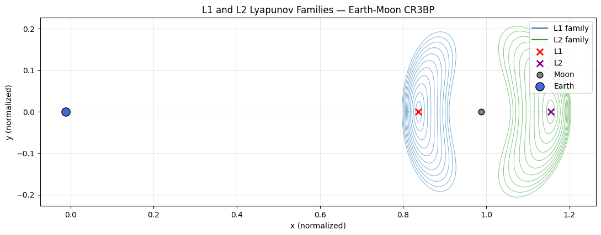

\# Research Log

\## 2026-05-27

\*\*Worked on:\*\* 

\- Project planning and environment setup.

\- 3Blue1Brown linear algebra series (math prep)

\*\*Setup completed:\*\*

\- Python 3.12 installed

\- Virtual environment created

\- Core scientific Python stack installed (numpy, scipy, matplotlib, jupyter, pytorch)

\- VSCode + Git configured

\- Project folder structure created

\- Git repository initialized

\*\*Reading completed:\*\*

\- Identified research direction: ML for QPIT identification in CR3BP

\*\*Stuck on / questions:\*\*

\- None yet — setup phase

\*\*Next session:\*\*

\- Begin reading Koon et al. Chapter 1

\## 2026-05-28

\*\*Worked on:\*\* 

\- Further planning, math learning, and environment setup

\*\*Setup completed:\*\*

\- Got the titan environment setup

\*\*Reading completed:\*\*

\- Completed learning a basic understanding of linear algebra

\*\*Stuck on / questions:\*\*

\- Is there any other ways of going about eigenvectors and eigendecomposition

\*\*Next session:\*\*

\- Learn multivariable calc and read Koon and Okihara

\-*Important notes
\- - on titan the are three partition that are useful: bw (the main one), sb (larger one), and gpu (contains gpus)
\- - sb and gpu could be used later for greater processing
\- - on bw, PreemptMode=REQUEUE, this means jobs should be checkpointable or idempotent (smaller separate jobs)

\## 2026-05-29

\*\*Worked on:\*\* 

\- Multivarible calc

\*\*Reading completed:\*\*

\- Gained a basic understanding of multivarible equations

\*\*Stuck on / questions:\*\*

\- None yet — setup phase

\*\*Next session:\*\*

\- Learn multivariable calc and read Koon and Olihara

\## 2026-05-31

\*\*Worked on:\*\* 

\- Multivarible calc

\*\*Reading completed:\*\*

\- Learned about partial derivatives of multivarible equations

\*\*Stuck on / questions:\*\*

\- None yet — setup phase

\*\*Next session:\*\*

\- Learn multivariable calc and read Koon and Olihara

\## 2026-06-01

\*\*Worked on:\*\* 

\- Multivarible calc

\*\*Reading completed:\*\*

\- Learned about gradient and directional derivatives

\*\*Stuck on / questions:\*\*

\- None yet — setup phase

\*\*Next session:\*\*

\- Learn multivariable calc and read Koon and Olihara

\## 2026-06-03

\*\*Worked on:\*\* 

\- Multivarible calc

\*\*Reading completed:\*\*

\- Learned about the chain rule for multivar and about curvature

\*\*Stuck on / questions:\*\*

\- None yet — setup phase

\*\*Next session:\*\*

\- Learn multivariable calc and read Koon and Olihara

\## 2026-06-04

\*\*Worked on:\*\* 

\- Multivarible calc

\*\*Reading completed:\*\*

\- Learned about divergence and curl for vector-valued functions

\*\*Stuck on / questions:\*\*

\- None yet — setup phase

\*\*Next session:\*\*

\- Learn multivariable calc, specifically Laplacian and Jacobian, and read Koon and Olihara

\## 2026-06-05

\*\*Worked on:\*\* 

\- Multivarible calc

\*\*Reading completed:\*\*

\- Learned about Jacobian, Laplacian, Lagrangian, tangent planes, and quadratic approximations.

\*\*Stuck on / questions:\*\*

\- None yet — setup phase

\*\*Next session:\*\*

\- Learn multivariable calc, specifically line integrals, and read Koon and Olihara

\## 2026-06-06

\*\*Worked on:\*\* 

\- Multivarible calc and reading

\*\*Reading completed:\*\*

\- Learned about line integrals and read the first chapters of Koon and Olikara

\*\*Stuck on / questions:\*\*

\- None yet — setup phase

\*\*Next session:\*\*

\- Learn multivariable calc, specifically double integrals

\## 2026-06-07

\*\*Worked on:\*\* 

\- Multivarible calc

\*\*Reading completed:\*\*

\- Learned about double integrals and triple integrals

\*\*Stuck on / questions:\*\*

\- None yet — setup phase

\*\*Next session:\*\*

\- Going to a summer camp and will have very little time to study Multivar Calc, will not be able to add entries into this log

\## 2026-06-14

\*\*Worked on:\*\* 

\- Came back from summer camp and worked on multivarible calc

\*\*Reading completed:\*\*

\- Learned about surface integrals

\*\*Stuck on / questions:\*\*

\- None yet — setup phase

\*\*Next session:\*\*

\- Multivar calc, specifically flux and different theorems

\## 2026-06-15

\*\*Worked on:\*\* 

\- Multivarible calc

\*\*Reading completed:\*\*

\- Learned about Stokes' theorem and variations of it

\*\*Stuck on / questions:\*\*

\- None yet — setup phase

\*\*Next session:\*\*

\- Final confirmation of comprehension of multivar calc and beginning ordinary diff eq

\## 2026-06-16

\*\*Worked on:\*\* 

\- Multivarible calc and ODE

\*\*Reading completed:\*\*

\- Confirmed fluency of multivar and began learning ODE

\*\*Stuck on / questions:\*\*

\- None yet — setup phase

\*\*Next session:\*\*

\- Continuing ODE

\## 2026-06-18

\*\*Worked on:\*\* 

\- ODE

\*\*Reading completed:\*\*

\- Watched the first few MIT OCW videos for ODE and began the first problem set.

\*\*Stuck on / questions:\*\*

\- None yet — setup phase

\*\*Next session:\*\*

\- Continuing ODE

\## 2026-06-19

\*\*Worked on:\*\* 

\- ODE and the cr3bp integrator

\*\*Reading completed:\*\*

\- Finished the first ODE problem set

\- Read the second chapter of Koon

\- Confirmed that the cr3bp integrator worked

\-Tested Jacobi conseration when starting with small velocity near L4 - passed
\-Tested Jacobi conseration when starting near L1 - failed
\-Tested Jacobi conseration when starting with tangential velocity near Earth - failed
\-Tested Jacobi conseration when starting near the Moon - failed

\-Plotted the zero-velocity curves for several Jacobi constants

\*\*Stuck on / questions:\*\*

\- None yet — setup phase

\*\*Next session:\*\*

\- Continuing ODE

\## 2026-06-20

\*\*Worked on:\*\* 

\- ODE

\*\*Reading completed:\*\*

\- Learned about systems of ODE

\*\*Stuck on / questions:\*\*

\- None yet — setup phase

\*\*Next session:\*\*

\- Continuing ODE

\## 2026-06-22

\*\*Worked on:\*\* 

\- ODE

\*\*Reading completed:\*\*

\- Learned how to classify fixed points of system of ODE

\- Read Pathak and learned about reservoir computing

\*\*Stuck on / questions:\*\*

\- None yet — setup phase

\*\*Next session:\*\*

\- Building a Lorenz Reservoir Computer

\## 2026-06-23

\*\*Worked on:\*\* 

\- Lorenz Reservoir Computer

\*\*Reading completed:\*\*

\- Pytorch 60 Minute Blitz

\- Tested the cr3bp integrator on the Titan
\- It worked but produced the greatest deviation around L1
\- This is most likely due to L1 being the most chaotic

\- Began the Reservoir Computer with the Lorenz Equations  
\- The Lorenz attractor is just so beautiful

\- When building the reservoir, it did not work unless it was fed normalized values
\- It would be smart to normalize values down the line for the actual QPIT identifier too
\- Its important to note that a model that scores well on training data may not score well on data it has never seen before
\- The finished reservoir computer was able to match real values for around 2 Lyapunov times
\- This result is worse than that of Pathak but the bug fixing and process were enough to learn the mechanics of a reservoir computer

\*\*Stuck on / questions:\*\*

\- None yet — setup phase

\*\*Next session:\*\*

\- Finishing ODE

\## 2026-06-24

\*\*Worked on:\*\* 

\- ODE 

\*\*Reading completed:\*\*

\- Learned about nonlinear systems of ODE
\- Learned you can use the local linearization to gain information about the phase portrait

\*\*Stuck on / questions:\*\*

\- None yet — setup phase

\*\*Next session:\*\*

\- Finishing ODE 

\## 2026-06-25

\*\*Worked on:\*\* 

\- ODE 

\*\*Reading completed:\*\*

\- Read Ch. 6 of Strogatz

\*\*Stuck on / questions:\*\*

\- None yet — setup phase

\*\*Next session:\*\*

\- Beginning Dynamical Systems

\## 2026-06-25

\*\*Worked on:\*\* 

\- Dynamical Systems

\*\*Reading completed:\*\*

\- Read Ch. 7 of Strogatz

\*\*Stuck on / questions:\*\*

\- None yet — setup phase

\*\*Next session:\*\*

\- Continuing Dynamical Systems

\## 2026-06-26

\*\*Worked on:\*\* 

\- Reading

\*\*Reading completed:\*\*

\- Read Koon Ch. 3

\*\*Stuck on / questions:\*\*

\- None yet — setup phase

\*\*Next session:\*\*

\- Continuing Reading

\## 2026-06-27

\*\*Worked on:\*\* 

\- Reading

\*\*Reading completed:\*\*

\- Read Olikara Ch. 2 and Howell

\*\*Stuck on / questions:\*\*

\- None yet — setup phase

\*\*Next session:\*\*

\- Developing the single-shooting differential corrector

\## 2026-06-28

\*\*Worked on:\*\* 

\- Jacobian and STM integration

\*\*Reading completed:\*\*

\- Derived the Jacobian for the CR3BP system

\- Validated the STM against small differences and it worked greatly

\*\*Stuck on / questions:\*\*

\- None yet — setup phase

\*\*Next session:\*\*

\- Developing the single-shooting differential corrector

\## 2026-06-29

\*\*Worked on:\*\* 

\- Single-Shooting Differential Corrector

\*\*Reading completed:\*\*

\- Built the single-shooting differential corrector and used it to find the first periodic orbit of the project

\- Used the eigenvectors of the Jacobian Matrix around L1 to get a good initial guess then used the differential corrrector to quadratically converge closer and closer to real orbit

\- The final QPIT identifier could be used to generate initial guesses for a similar process

\- Generated a families of Lyapunov orbits around L1 and L2
\- Ran into errors and diffulcties with the differential corrector jumping to different branches of families or zeroing out
\- This error was caused by using a fix distance between consecutive orbits
\- Fixed by using a pseudo arclength

\*\*Stuck on / questions:\*\*

\- None yet — setup phase

\*\*Next session:\*\*

\- Floquet Theory

\## 2026-06-29 (part 2)
\# Did a lot today so decided to split it up

\*\*Worked on:\*\* 

\- Floquet theory

\*\*Reading completed:\*\*

\- What I learned today connected everything of the project so far
\- I now have a much better understanding of the mechanics

\- I previously thought that QPITs were an entirely different thing from periodic orbits but now I understand that they revolve around a certain type of them
\- They are orbits with two frequencies, the first one is the same as a normal periodic orbit
\- What makes it a torus is its second frequency which makes a circle perpendicular to the path of the first orbit
\- What makes it quasi-periodic is that the ratio of the frequencies is irrational, they path of the orbit never lines up with itself when it comes back around

\- Also, floquet theory is an amazing way of understanding orbits

\- Used it to calculate that the families of orbits I produced earlier were all hyperbolic
\- This fact means that they are likely no tori around them
\- Tori are near stable orbits, so in the future it would be best to investigate halo, or other orbits

\*\*Stuck on / questions:\*\*

\- None yet — setup phase

\*\*Next session:\*\*

\- Halo Orbits

\## 2026-06-30

\*\*Worked on:\*\* 

\- Manifolds

\*\*Reading completed:\*\*

\- Read Koon Ch. 4, Gomez, and the first half of Burden & Faires Ch. 5

\- Hartman-Grobman legitimizes the method of findind manifolds from a periodic orbit'
\- At the point where the two over lap they are tangent, thus the linearization of the periodic orbit at a point can be used to find the start or end of a manifold

\- Generated stable and unstable manifolds for a L1 Lyapunov orbit
\- Unstable comes from and stable goes into the orbit
\- The manifolds assymptotically approaches and comes from the orbit

\- In preperation for halo orbits, I expanded the existing system into 3d (because halos are 3d) and created a new, more complex jacobian and STM to accompany it
\- This STM was validated and is ready to produce halos

\*\*Stuck on / questions:\*\*

\- None yet — setup phase

\*\*Next session:\*\*

\- Halo Orbits

\## 2026-07-01

\*\*Worked on:\*\* 

\- Halo Orbits

\*\*Reading completed:\*\*

\- Calculated families of Halo Orbits around L1 and L2 using all of the preexisting infrastructure of the project

\- These are where I suspect QPITs to live around and the monodromy eigenvalues already have center pairs
\- I am right on the cusp of calculating QPITs for this project

\*\*Stuck on / questions:\*\*

\- None yet — setup phase

\*\*Next session:\*\*

\- QPIT reading

\## 2026-07-02

\*\*Worked on:\*\* 

\- Halo Orbits Floquet Analysis

\*\*Reading completed:\*\*

\- Analysed the floquet multipliers of the Halo Families I generated to look for where QPITs could be near

\- The two best candidates:
\-L1 orbit 16 — C=3.077, ρ=0.272
\-L2 orbit 29 — C=3.060, ρ=0.295

\- This is my last real session before going to the National Youth Science Camp
\- At camp I will:  
\- -Read all relevent material about generating QPITs
\- -Choose the method I will implement to actually do so
\- -And reach out to Olikara and Baresi asking for their help

\- All of this will be in preparation for when I come back from camp in a month
\- When I come back, I will be jumping straight into the most difficult part of the project: Computind QPITs
\- Hopefully all of the preparation of done before camp and will do during camp will set me up to succeed after it
\- So until I return, Goodbye

\*\*Stuck on / questions:\*\*

\- None yet — setup phase

\*\*Next session:\*\*

\- QPIT Computation